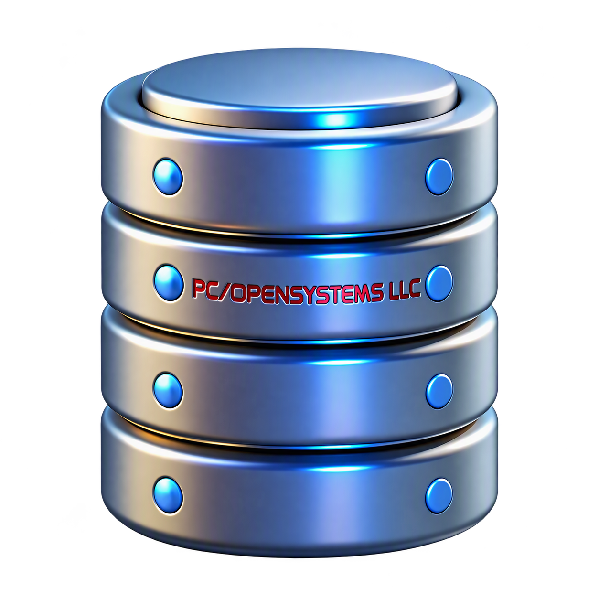

# PC/OpenData SQL Server v27.0

<p align="center">
  
</p>

<p align="center">
  <a href="LICENSE"></a>
  <a href="https://en.wikipedia.org/wiki/C11_(C_standard_revision)"></a>
  
  
  
  
  
  
</p>

---

## 💡 What is PC/OpenData?

**PC/OpenData SQL Server (pcodSQL)** is a lean, ultra-fast, embeddable, and standalone ACID relational database and vector search engine written in pure ISO C11. 

Originally developed in 2006 for mission-critical Oracle Solaris workloads and maintained for two decades by **PC/OpenSystems LLC**, PC/OpenData has evolved into a modern, cloud-native, and enterprise-grade database for modern Windows Server and Enterprise Linux environments.

The entire server compiles into a self-contained, single-binary footprint (~1.38 MB on Windows x64, ~4.7 MB compressed Alpine container) with **zero third-party runtime dependencies**. All cryptographic and network primitives rely exclusively on OS-native security libraries (Windows CNG/Schannel/SSPI or POSIX OpenSSL/GSSAPI).

> **Implementation Note:** The engine is implemented in strict ISO C11. In accordance with our engineering transparency guidelines, **AI-assisted coding accounts for 12% of the code written**, fully backed by human architectural oversight, manual verification, and 3,716 automated regression tests.

### Deployment Modes:
1. **Interactive SQL Terminal:** A feature-rich terminal with live line-editing, reverse history search (`Ctrl+R`), candidate tab completion, optional semicolons, multiple result formats (`table`, `markdown`, `json`, `csv`), and a full-screen text editor (**IRIS**).
2. **Background Network Server:** High-concurrency asynchronous reactor with native TLS, role-based access control (RBAC), and **PostgreSQL v3 wire protocol compatibility** for drop-in connectivity from standard client tools (`psql`, DBeaver, pgAdmin).
3. **Turnkey Containers (Docker / Podman):** Ultra-compact (~4.7 MB compressed, ~12 MB uncompressed) non-root Alpine container images with pre-configured healthchecks, automated backups, and Compose orchestration.
4. **Native Windows Service:** Direct Service Control Manager (SCM) integration for production Windows environments (`--install-service`, `--start-service`, etc.).
5. **In-Process Embedded C Library:** Drop the single-file amalgamation `src/opendata.c` and `include/opendata.h` directly into any C, C++, Rust, Go, or Python application.

---

## 🖥️ Supported Operating Systems, Platforms & Containers

PC/OpenData SQL Server is validated and officially supported across the following enterprise operating systems, platforms, and container runtimes:

| Platform Family | Supported Versions / Distributions | Packaging / Runtime |
|---|---|---|
| **Microsoft Windows** | **Windows 10**, **Windows 11**<br />**Windows Server 2019**, **Windows Server 2022**, **Windows Server 2025** | Native Win32/Win64 binary, SCM Service, System Installer (`install.ps1`) |
| **Enterprise Linux** | **Red Hat Enterprise Linux (RHEL) 10**<br />**Oracle Linux 10**<br />**Rocky Linux 10**<br />**AlmaLinux 10**<br />**Fedora 45**<br />**Azure Linux 4** | Native ELF64 binary, RPM packages (`.rpm`), Systemd service unit (`opendata.service`) |
| **BSD & UNIX** | **FreeBSD 15**<br />**Oracle Solaris** | Native POSIX binary |
| **Containers & Microservices** | **Docker Engine**, **Docker Desktop**, **Podman**, **Kubernetes**<br />*(Security-hardened Alpine Linux OCI base)* | Offline Image Archives (`docker/pc-opendata-27.0.tar.gz`, `docker/pc-opendata-latest.tar.gz`), `Dockerfile`, `docker-compose.yml` |

---

## ⚡ Key Highlights (v27.0 Enterprise)

- 🚀 **Blazing Fast Startup & Minimal Footprint:** Starts in under **5 milliseconds** with a tiny ~1.38 MB binary footprint.
- 💾 **Dual Storage Engines:**
  - *In-Memory Copy-on-Write (CoW):* Microsecond transactions and instant snapshot rollbacks.
  - *Slotted Disk Pages (`ENGINE = DISK`):* 4KB slotted binary records, persistent B+ Tree indexes, and CLOCK buffer pool for datasets exceeding RAM.
- 🧠 **Native AI Vector Search (HNSW):** Built-in `VECTOR(dim)` type, Cosine Distance (`<=>`), Euclidean L2 (`<->`), and Inner Product (`<#>`), accelerated by multi-layer **HNSW (Hierarchical Navigable Small World)** indexing and 8-bit **Scalar Quantization (SQ8)**.
- 🐘 **PostgreSQL v3 Wire Protocol Compatibility:** Native protocol sniffing allows standard PostgreSQL drivers (`psql`, DBeaver, pgAdmin, Python `psycopg2`/`asyncpg`, Go `pgx`, Node `pg`) to connect seamlessly on port `7338`.
- ⏱️ **Continuous WAL Archiving & Point-In-Time Recovery (PITR):** Differential write-ahead log archiving with exact-second historical replay rollback.
- 🪟 **Native Windows Service Integration:** First-class Windows SCM lifecycle commands for hands-off background operation.
- 📊 **ISO SQL Window Functions & JSON Path Extraction:** `ROW_NUMBER()`, `RANK()`, `DENSE_RANK()`, `OVER (PARTITION BY ... ORDER BY ...)`, and native arrow operators (`col->'path'`, `col->>'path'`).
- 🏢 **Enterprise Identity & SSO:** Native Active Directory (UPN binds), OpenLDAP group resolution, and Kerberos v5 / SPNEGO single sign-on.
- 🔄 **3-Node Raft Consensus & HA:** Synchronous quorum WAL replication with automatic failover guaranteeing zero data loss.
- 🛡️ **TDE & Tamper-Evident Audit:** AES-256-GCM encrypted database snapshots, SHA-256 tamper-evident cryptographic log chains, and memory zeroization.
- 📦 **Dual Source Layout:** Compiles as 38 modular translation units or as a single-file amalgamation (`src/opendata.c`).

---

## 🚀 Quick Start (Under 60 Seconds)

### 1. Build from Source

Building requires an ISO C11 compiler (Clang, GCC, or CC).

**Windows (PowerShell / Command Prompt):**
```cmd
:: Modular build (verifies all 13 test suites automatically)
build.bat

:: Or build single-file amalgamation:
build.bat -Amalgamation
```

**Linux / FreeBSD / Oracle Solaris:**
```bash
# Make executable (if needed) and run modular build with TLS:
chmod +x build.sh
./build.sh

# Or build from single-file amalgamation:
./build.sh --amalgamation
```

---

### 2. Launch the SQL Console

Create or open a database file (`.pcod`):

```bash
# Windows
.\bin\opendata.exe mydata.pcod

# Linux
./bin/opendata mydata.pcod
```

Inside the interactive shell, run standard SQL:

```sql
-- 1. Create a table
CREATE TABLE employees (
    id NUMBER PRIMARY KEY,
    name VARCHAR2(50) NOT NULL,
    department VARCHAR2(30),
    salary NUMBER
);

-- 2. Insert records
INSERT INTO employees VALUES (101, 'Ada Lovelace', 'Engineering', 125000);
INSERT INTO employees VALUES (102, 'Alan Turing', 'Research', 130000);
INSERT INTO employees VALUES (103, 'Grace Hopper', 'Engineering', 135000);

-- 3. Commit your transaction
COMMIT;

-- 4. Query your data
SELECT department, COUNT(*) AS headcount, AVG(salary) AS avg_sal
FROM employees
GROUP BY department
ORDER BY avg_sal DESC;
```

---

### 3. Interactive Shell Ergonomics

The interactive shell provides terminal-level ergonomics across Windows and POSIX:

* **Line-Editing & History:** ANSI raw mode navigation (`Up`/`Down` history, `Left`/`Right`/`Home`/`End` cursor movement) with **Reverse History Search (`Ctrl+R`)**.
* **Optional Semicolons:** Complete single-line statements execute immediately upon pressing `Enter`. In multi-line buffers (`...>`), pressing `Enter` on a blank line executes the statement.
* **Intelligent Tab Autocompletion:** Autocompletes SQL keywords, dot-commands, table names, and column schemas into a formatted candidate grid.
* **Flexible Output Formats:**
  ```sql
  .mode table       -- Clean ASCII box grid (default)
  .mode markdown    -- GitHub Flavored Markdown table
  .mode json        -- Streaming JSON array of records
  .mode csv         -- RFC 4180 CSV output
  .mode vertical    -- Key-value row inspector (\G style)
  .mode pager on    -- Automatically paginate large results
  ```
* **IRIS Text Editor:** Type `EDIT;` to open the full-screen terminal editor for editing multi-line queries and complex CTEs (`Ctrl+O` Save, `Ctrl+R` Execute, `Ctrl+X` Exit).
* **Built-in Self-Test Engine:** Verify engine integrity anytime directly from the binary:
  ```bash
  opendata self-test
  ```
  Runs 3,716 automated regression assertions across 13 test suites in under 1 second.

---

## 🧠 AI Vector Embeddings & Similarity Search

PC/OpenData natively supports dense vector embeddings, distance operators, and multi-layer HNSW graph indexing:

```sql
-- 1. Create a table with 3-dimensional embeddings
CREATE TABLE articles (
    id NUMBER PRIMARY KEY,
    title VARCHAR2(100),
    embedding VECTOR(3)
);

-- 2. Insert embeddings
INSERT INTO articles VALUES (1, 'Kernel Architecture', '[0.90, 0.10, 0.05]');
INSERT INTO articles VALUES (2, 'Database Indexing',   '[0.85, 0.20, 0.15]');
INSERT INTO articles VALUES (3, 'Deep Learning LLMs',  '[0.10, 0.95, 0.20]');

-- 3. Create an HNSW index for sub-millisecond approximate nearest neighbor retrieval
CREATE INDEX idx_articles_hnsw ON articles USING HNSW (embedding);

-- 4. Retrieve top matches using Cosine Distance (<=>)
SELECT title, embedding <=> '[0.92, 0.12, 0.08]' AS distance
FROM articles
ORDER BY distance ASC
LIMIT 2;
```

### Supported Distance Operators:
| Operator | Metric | Best For |
|---|---|---|
| `<=>` | **Cosine Distance** | Text embeddings (OpenAI, HuggingFace, Cohere) |
| `<->` | **Euclidean L2 Distance** | Image vectors, spatial data, metric spaces |
| `<#>` | **Negative Inner Product** | Normalized vectors, maximum inner-product search |

---

## 🌐 Background Server & PostgreSQL v3 Wire Compatibility

Run PC/OpenData as a secure background network server:

```bash
opendata --database /var/lib/opendata/production.pcod \
         --tcps --port 7338 \
         --cert /etc/opendata/server.pem \
         --key /etc/opendata/server-key.pem \
         --bind 0.0.0.0
```

### Connect via PostgreSQL Clients
PC/OpenData natively speaks PostgreSQL v3 wire protocol:
```bash
# Connect with standard psql CLI
psql -h localhost -p 7338 -U admin -d production
```
Compatible out-of-the-box with **DBeaver**, **pgAdmin**, **Python `psycopg2`/`asyncpg`**, **Node.js `pg`**, and **Go `pgx`**.

---

## 🪟 Windows Service Management

PC/OpenData integrates directly with the Windows Service Control Manager (SCM):

```cmd
:: Register as a background Windows Service
opendata --install-service OpenDataSQL

:: Start the service
opendata --start-service OpenDataSQL

:: Stop the service
opendata --stop-service OpenDataSQL

:: Deregister the service
opendata --uninstall-service OpenDataSQL
```

---

## ⏱️ Continuous WAL Archiving & Point-In-Time Recovery (PITR)

Protect mission-critical data with exact-second historical recovery:

```bash
# 1. Enable automated continuous WAL archiving during server execution
opendata --database production.pcod --backup-dir /var/backups/opendata

# 2. Restore to an exact historical Unix timestamp (second-level precision)
opendata --database production.pcod \
         --backup-dir /var/backups/opendata \
         --pitr 1794285600
```
The engine locates the base snapshot, sorts archive segments chronologically, and replays deltas up to the exact requested epoch second.

---

## 📦 Packaging & Installation

### Windows System-Wide Installation
The Windows installer installs to `C:\Program Files\OpenDataSQL\bin` and configures the system `PATH` for all users:

```powershell
# Run from administrative PowerShell
.\install.ps1
```

Pre-packaged Windows release zip bundles are located in [`installer/`](installer/).

### Linux RPM Package
For Enterprise Linux (RHEL 9/10, Rocky Linux, CentOS Stream, AlmaLinux, Fedora):

```bash
# Build the RPM locally
bash linux/build_rpm.sh

# Install the package
sudo rpm -ivh linux/pc-opendata-27.0-1.el10.x86_64.rpm

# Enable and start the systemd daemon
sudo systemctl enable --now opendata
```

### Docker & Podman Container
A lightweight (~4.7 MB compressed, ~12 MB uncompressed), non-root Alpine container image with pre-configured healthchecks and automated backups:

```bash
# 1. Load the pre-packaged offline image archive
docker load -i docker/pc-opendata-27.0.tar.gz

# 2. Start with Docker Compose
docker compose -f docker/docker-compose.yml up -d

# 3. Or launch an interactive container
docker run -it --rm -v opendata_data:/data pc-opendata:27.0 /data/production.pcod
```

---

## 🔌 Language Bindings & Tools

- **Python:** [`bindings/python/`](bindings/python/) (`import opendata`)
- **Node.js:** [`bindings/node/`](bindings/node/) (`const opendata = require('opendata')`)
- **VS Code Extension:** [`vscode-extension/`](vscode-extension/) (Syntax highlighting, live schema tree viewer, code lens query execution, CBO plan visualizer)
- **Embedded C/C++:** Drop `src/opendata.c` and `include/opendata.h` into your build.

---

## 📚 Documentation & Reference

- [**Official User Guide**](user_guide.md) — Comprehensive guide covering SQL syntax, DDL/DML, CBO plans, Raft HA, and configuration.
- [**Release Notes (v27.0)**](release_notes.md) — Executive summary of 27.0 enterprise capabilities and security remediations.
- [**Changelog**](pcodSQL-changelog.txt) — Historical evolution and milestone logs.
- [**License (BSD-3-Clause)**](LICENSE) — Permissive license for open, commercial, and embedded applications.

---

<p align="center">
  <b>PC/OpenData SQL Server</b> is maintained by <b>PC/OpenSystems LLC</b>.<br />
  For enterprise support and commercial deployments, visit <a href="https://www.pc-opensystems.com">pc-opensystems.com</a>.
</p>
